# CardApp - Documentazione completa

CardApp e' l'app per i clienti degli esercenti: mostra le card fedelta' (saldo punti, contatori, movimenti) di uno o piu' account e genera il QR da esibire in cassa. Ogni account e' legato a un esercente.

Il documento e' diviso in due parti:

- Parte A: manuale utente (cosa fa l'app e come si usa)
- Parte B: manuale tecnico (architettura, servizi, sicurezza, installazione, diagnosi)

---

# PARTE A - MANUALE UTENTE

## A1. Concetti base

| Termine | Significato |
|---|---|
| Esercente | Il negozio/azienda che ha emesso le card e presso cui il cliente e' registrato |
| Codice esercente | Codice alfanumerico (4-32 caratteri) che identifica l'esercente; si ottiene da QR o link, oppure si digita |
| Account | Coppia email + esercente. Lo stesso cliente puo' avere piu' account (esercenti diversi o email diverse) |
| Card | Tessera assegnata al cliente dall'esercente, con codice di 6 caratteri e uno o piu' contatori |
| Contatore | Saldo associato alla card (oggi l'app gestisce i punti) |
| Codice di sblocco | PIN di 4 cifre che protegge l'apertura dell'app |

Tipi di card mostrati: Standard (fedelta'), Prepagata, Postpagata, Gift card. Ogni tipo ha un colore predefinito; se l'esercente ha scelto un colore per la card, vale quello.

## A2. Primo avvio e accesso

All'apertura, se non esiste una sessione salvata, compare il login. Il flusso cambia in base a come si arriva.

Le schermate sono in `docs/screens/`.

### Accesso con link o QR dell'esercente
Il QR dell'esercente contiene `cardapp://e/<codice>`. Inquadrandolo con la fotocamera del telefono (o aprendo il link) l'app si apre direttamente sulla schermata di accesso gia' collegata a quell'esercente. Il codice non viene mostrato; nel sottotitolo compare il nome dell'esercente ("Accedi a ...").

### Accesso senza link (primo avvio)
1. Pagina "Scegli l'esercente": si puo' toccare un esercente gia' salvato, scansionare il QR con la fotocamera integrata, oppure digitare il codice. Mentre si digita il codice viene verificato sul server (dopo mezzo secondo di pausa) e sotto il campo appare il nome dell'esercente. "Continua" si abilita solo a codice verificato.
2. Pagina "Credenziali": email e password, poi "Accedi".

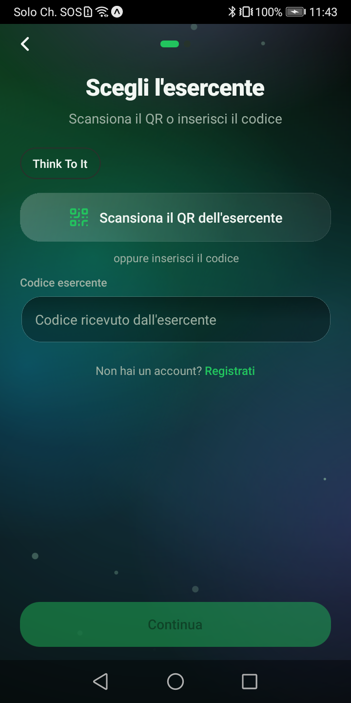
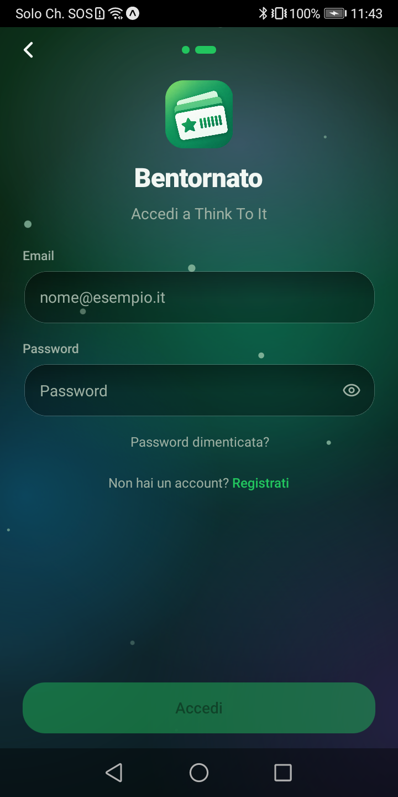

### Accesso con account gia' salvati
Se sul telefono ci sono account salvati, la prima pagina e' "Bentornato - Scegli con quale account entrare". Si seleziona l'account (e' preselezionato l'ultimo usato) e si preme "Accedi con Face ID" (iOS) o "Accedi con impronta" (Android). Dopo la verifica biometrica si entra con la password salvata, senza riscriverla.
- Se il telefono non ha nessuna protezione (niente biometria ne' blocco schermo), la verifica non viene richiesta.
- Se il server rifiuta la password salvata (per esempio perche' cambiata), l'app passa alle credenziali con email ed esercente gia' compilati e mostra "La password salvata non e' piu' valida: inseriscila di nuovo".
- Con la X accanto a un account lo si toglie dal telefono (previa conferma). Non viene eliminato: si potra' riaccedere con email e password.
- "Usa un altro account" porta alla scelta esercente e alle credenziali.

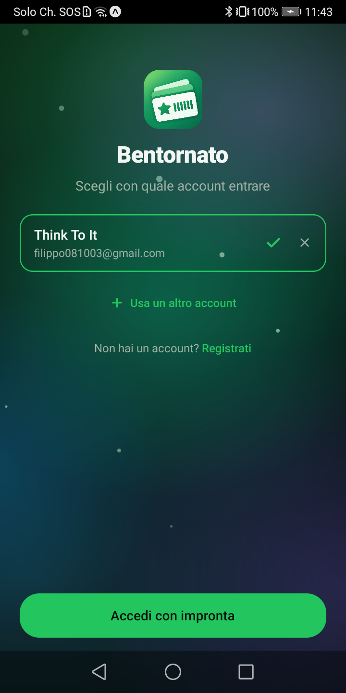

### Account non confermato o credenziali errate
Se il server rifiuta l'accesso (non per un problema di rete), sotto il campo password compare il messaggio del server ("nome utente o password non valide") e il link "Non hai ricevuto l'email di conferma?" per reinviare l'email di conferma. Il link "Password dimenticata?" e' sempre presente.

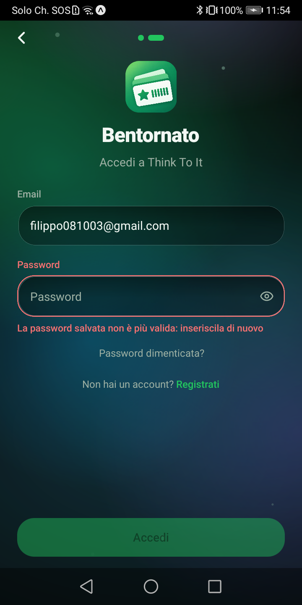

### Scanner QR
Dalla scelta dell'esercente, "Scansiona il QR dell'esercente" apre la fotocamera a schermo intero. Alla prima richiesta si deve consentire l'uso della fotocamera. Un QR non riconosciuto mostra "Questo QR non e' di un esercente CardApp".

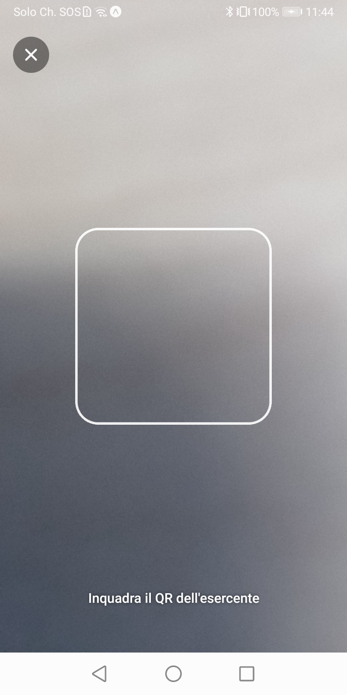

## A3. Registrazione

Dal login, "Non hai un account? Registrati". Passi:

1. Scelta esercente (solo se non si arriva da link/QR).
2. Profilo: nome, cognome (obbligatorio), telefono (facoltativo, es. +39 333 1234567).
3. Credenziali: email e password.

Regole di validazione (prima di chiamare il server):
- Il cognome e' obbligatorio.
- L'email deve essere nel formato valido.
- La password deve avere almeno 8 caratteri e non puo' iniziare o finire con uno spazio.

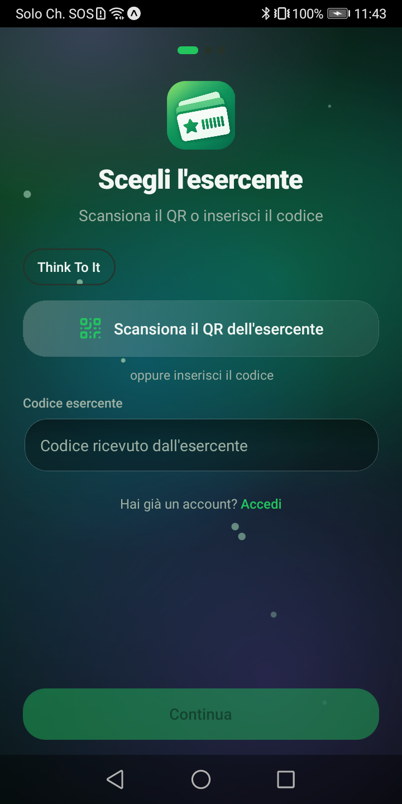
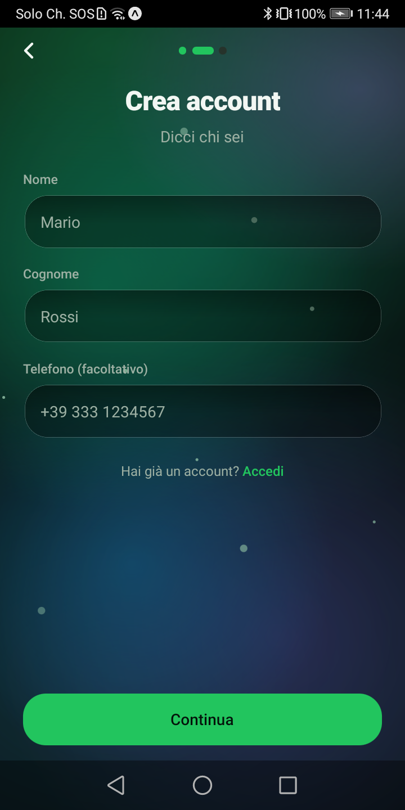
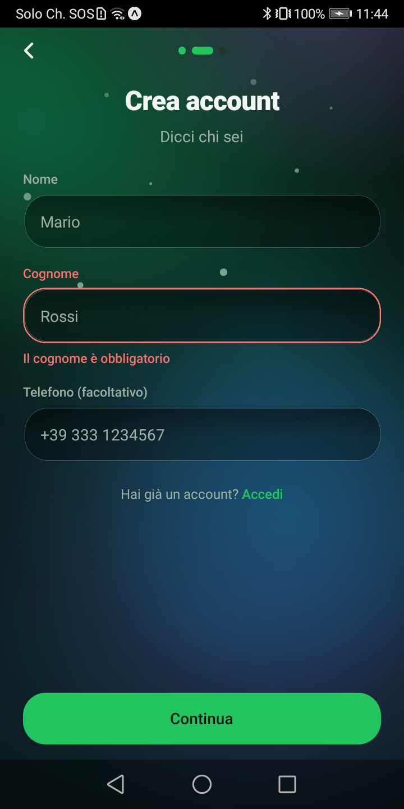

Esito:
- Se l'esercente richiede la conferma via email, compare "Controlla la tua email": si apre il link ricevuto e poi si accede dal login.
- Altrimenti l'account e' attivo e si entra subito.

## A4. Password dimenticata e conferma account

Schermata "Password dimenticata": si inserisce l'email (e il codice esercente se non si arriva da link e non ci sono account salvati) e si preme "Invia email". Per sicurezza il messaggio e' sempre "Se l'account esiste, riceverai un'email con il link per reimpostare la password". "Invia di nuovo" permette di rinviarla.

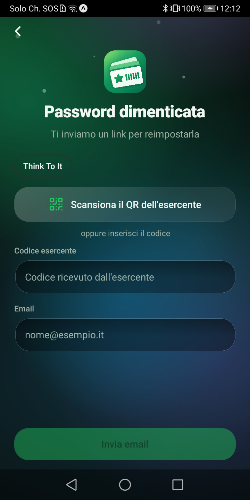

La stessa schermata in modalita' "Conferma account" reinvia l'email di conferma della registrazione.

Dal profilo, nella lista account, il pulsante con la chiave invia il link di recupero per quell'account specifico senza richiedere di nuovo i dati.

## A5. Home - "Le mie card"

La home mostra le card di tutti gli account salvati, raggruppate per account (esercente + email). L'account in uso e' sempre il primo.

- Con piu' account, ogni gruppo ha un'intestazione che si puo' comprimere/espandere con un tocco.
- Se un account non ha card: "Nessuna card". Se il caricamento di quell'account e' fallito, compare il messaggio d'errore sotto l'intestazione (le card gia' mostrate non spariscono).
- Se non ci sono card in nessun account: illustrazione "Nessuna card - Le tue card compariranno qui, con saldo e codice QR, non appena ti verranno assegnate."
- Tirando verso il basso la lista si aggiorna, anche nello stato vuoto. L'aggiornamento avviene anche in automatico quando l'app torna in primo piano.
- In alto a sinistra l'icona profilo, in alto a destra "+" per aggiungere un account.

### La card
- Fronte: nome dell'esercente, tipo, saldo (punti) e codice. Un pulsante sulla card apre i dettagli.
- Toccando la card si gira e mostra il QR del codice card, da far leggere in cassa. Alla comparsa del QR la luminosita' dello schermo sale al massimo (con transizione graduale) e viene ripristinata quando la card si richiude.
- Una card bloccata mostra la scritta BLOCCATA, ha il bordo rosso e non si gira: il QR non e' disponibile.
- Le card si inclinano leggermente con il movimento del telefono (effetto parallasse con lo sfondo).
- Il saldo e' sempre mostrato con l'etichetta "Punti" (l'app gestisce solo i contatori a punti), anche per prepagata, postpagata e gift card.
- Colori: standard verde, prepagata azzurro, postpagata viola, gift card oro; se l'esercente ha scelto un colore vale quello (la card bloccata di prova e' rossa perche' il suo dettaglio ha quel colore).

Elenco card (account con card di tipo diverso e una bloccata):

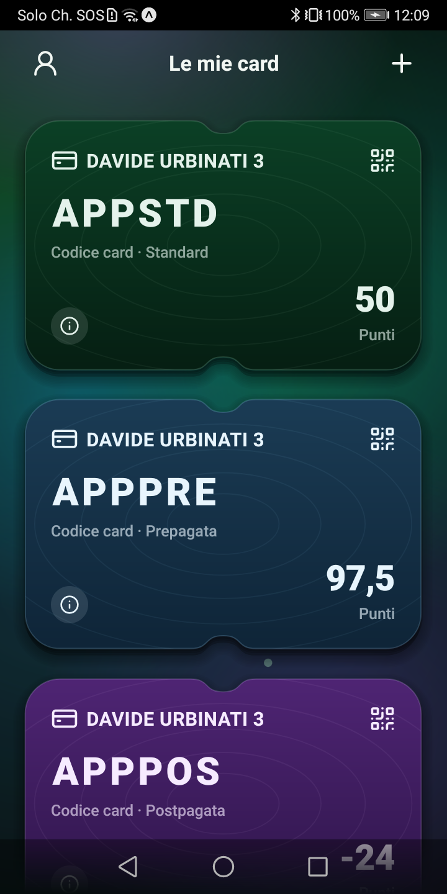
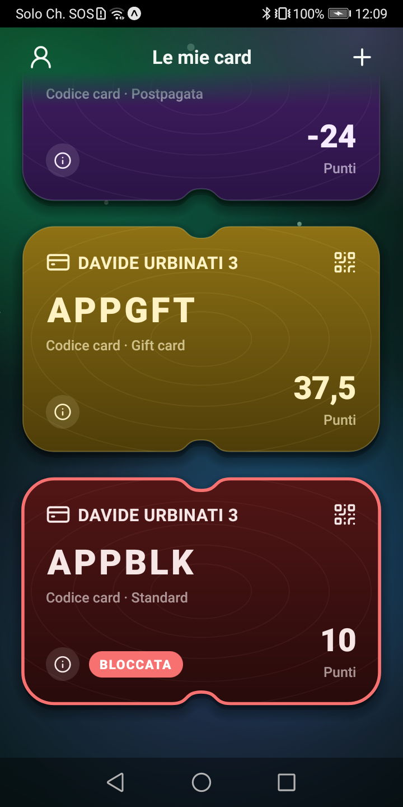

Stato vuoto (account senza card):

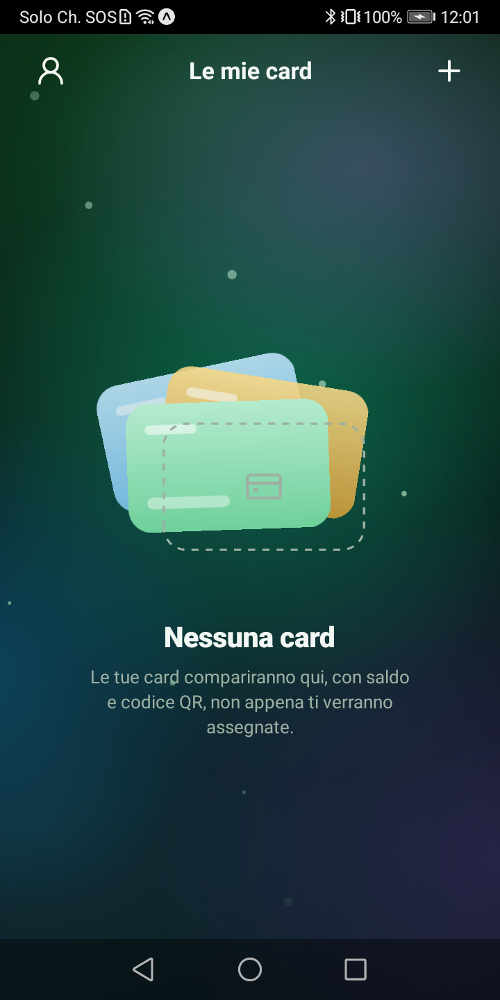

Card girata con il QR da mostrare in cassa:

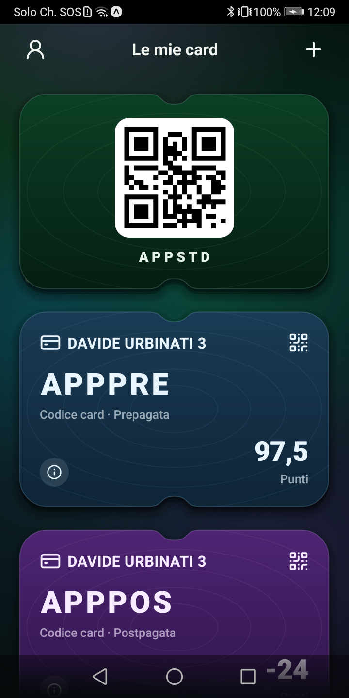

## A6. Dettagli card

Aprendo i dettagli:

- **Saldi e contatori**: un riquadro per ogni contatore. Il tipo determina etichetta e formato: Saldo (euro), Punti, Sconto (percentuale), Card standard ("Nessun saldo"), Contatore (altro). Viene indicato l'esercente o il circuito a cui appartiene il contatore e l'eventuale limite.
- **Informazioni**: codice, tipo, stato (Attiva/Bloccata), emessa da (con citta'), riferimento, note, card master, data di inserimento, ultimo utilizzo. Compaiono solo le righe valorizzate.
- **Movimenti**: elenco dal piu' recente a pagine da 20; "mostra altri" carica la pagina successiva. Tipi: Ricarica, Spesa, Accredito. Per ogni movimento: data/ora, importo con segno, saldo dopo, descrizione, documento, esercente, circuito, e le righe di dettaglio (descrizione, quantita', totale). Al primo caricamento compaiono righe segnaposto.
- **Blocca card / Sblocca card**: il blocco chiede conferma ("La card non potra' essere usata finche' non la sblocchi"), lo sblocco e' immediato. Se la card era gia' nello stato richiesto, un avviso lo comunica.
- Tirando verso il basso si aggiornano card e movimenti.
- Toccando un movimento si espande e mostra l'esercente, il documento e le righe (quantita', articolo, totale in euro).

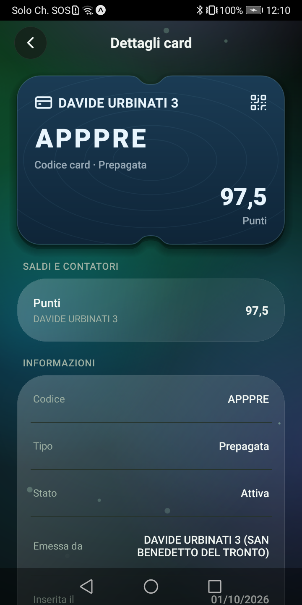
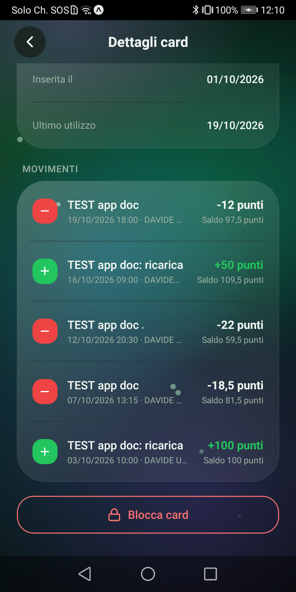
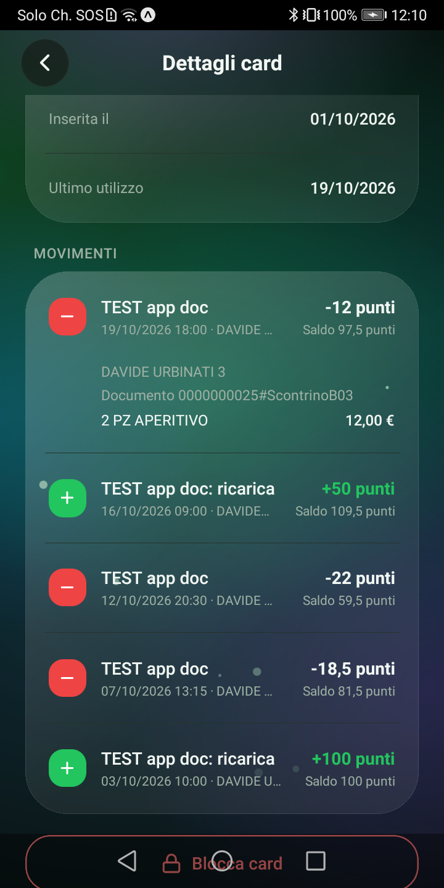
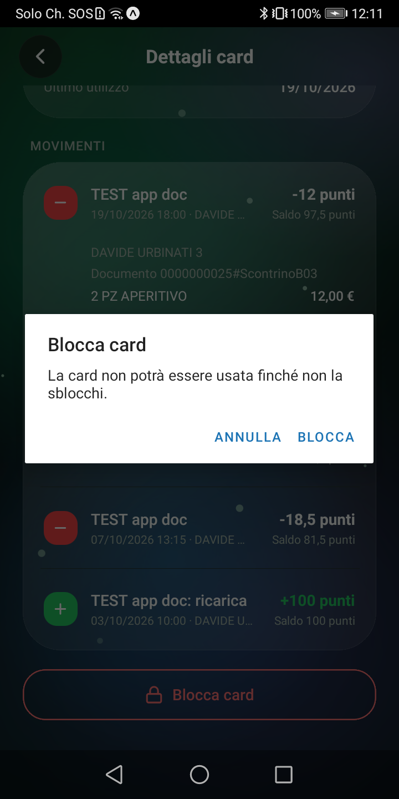
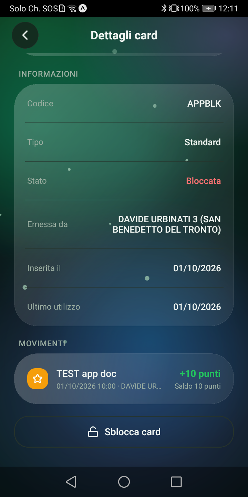

## A7. Profilo

Mostra i dati dell'account in uso:
- Avatar con iniziali, nome e cognome.
- Riepilogo: numero di card, card attive, punti totali (somma dei saldi punti). Finche' le card non sono arrivate i valori sono "-".
- Esercente, email, telefono (se presente).
- **Esci** (icona in alto a destra): chiede conferma ("Resta salvato su questo telefono: dal login potrai rientrare con Face ID o impronta") e riporta al login senza dimenticare l'account.
- **Lista account** (compare con piu' account salvati): tocco su una riga per passare a quell'account; chiave per il recupero password; "-" rosso per toglierlo dal telefono.
- **Proteggi app**: interruttore per attivare/disattivare il codice di sblocco.
- **Sblocco biometrico**: compare solo con codice attivo e biometria configurata sul telefono (Face ID o impronta al posto del codice). Sul telefono di prova non e' presente.
- **Cambia codice**.
- **Elimina account** (in fondo, rosso).

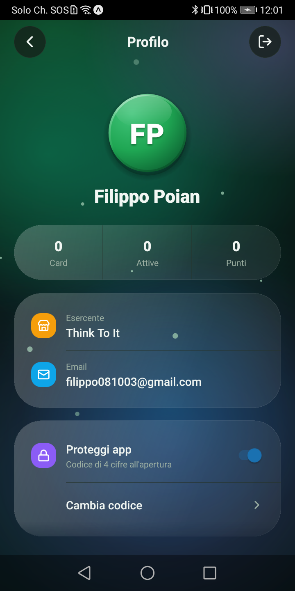
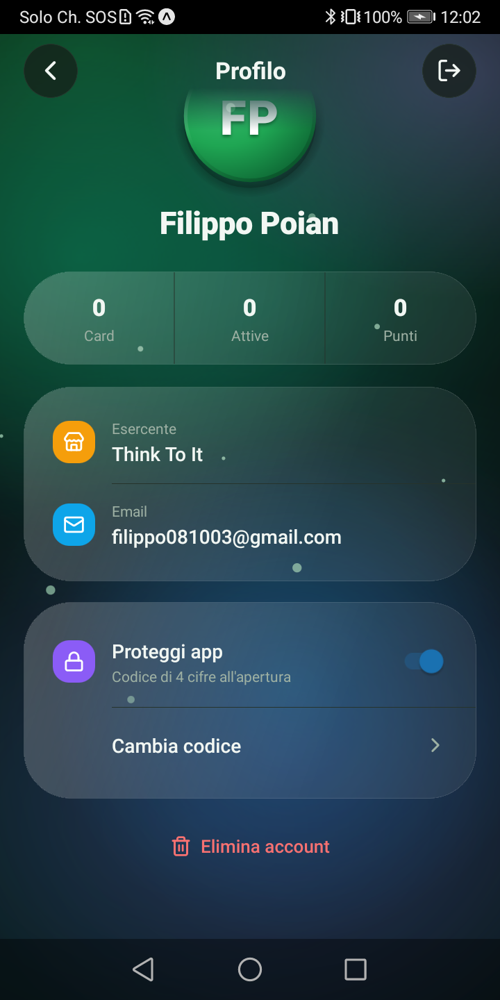

## A8. Aggiungere un altro account

Il "+" della home (o un link/QR di un altro esercente aperto con l'app gia' dentro) porta a "Aggiungi account": scelta esercente (saltata se arrivati da link/QR) e credenziali. L'account viene aggiunto agli altri, diventa quello attivo e le card si ricaricano. Gli account esistenti non vengono toccati. La pagina della scelta esercente ha anche "Password dimenticata?" e "Annulla".

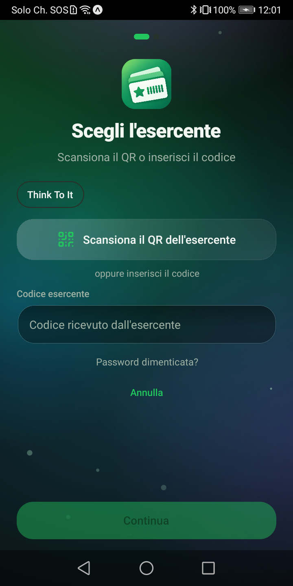

## A9. Codice di sblocco (PIN)

### Attivazione
Profilo - "Proteggi app": si sceglie un codice di 4 cifre e lo si ripete per conferma. Il codice resta solo sul telefono e vale per tutti gli account.

### Quando viene richiesto
- All'avvio dell'app, se il codice e' attivo (anche prima del login).
- Quando si torna all'app dopo che e' rimasta in secondo piano per almeno 30 secondi.
- Con la biometria attiva, Face ID/impronta viene proposta da sola all'apparire del tastierino; se annullata si usa il codice.

### Copertura della privacy
Appena l'app esce dal primo piano viene coperta da una schermata con il solo logo, cosi' l'anteprima del multitasking non mostra card ne' QR.

### Tentativi sbagliati
- Si hanno 5 errori liberi; il messaggio indica i tentativi rimasti prima del blocco.
- Al 5° errore i tentativi si bloccano per 30 secondi, poi il tempo raddoppia a ogni errore successivo fino a un massimo di 30 minuti. Il conto alla rovescia resta anche se si chiude e riapre l'app.
- Un codice corretto azzera i contatori.

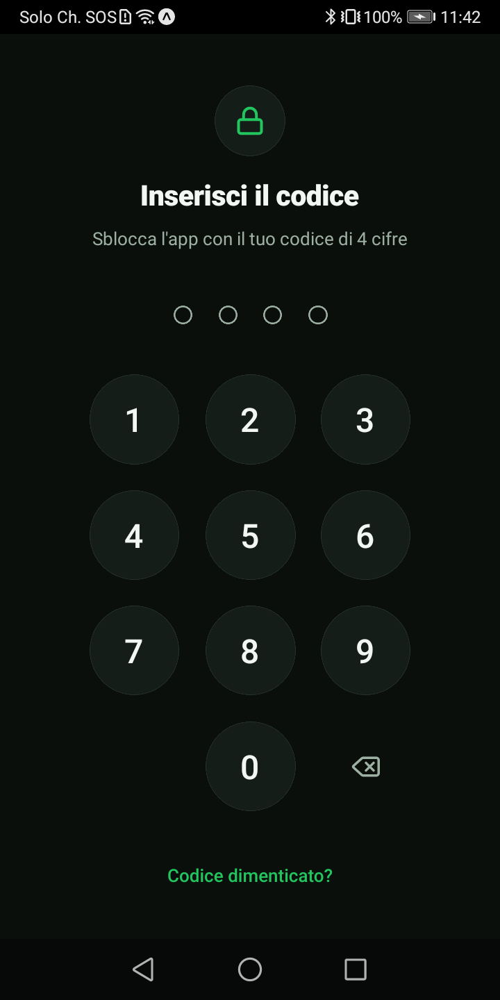

### Cambiare o disattivare il codice
Profilo - "Cambia codice" / interruttore "Proteggi app": si chiede prima il codice attuale.

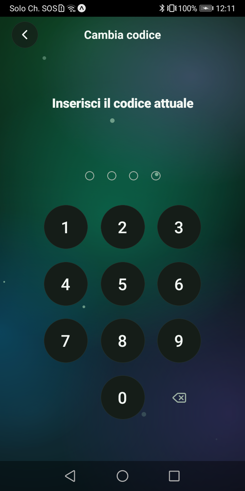

### Codice dimenticato
Dalla schermata del codice, "Codice dimenticato": si sceglie uno degli account salvati e se ne digita la password (verificata dal cloud). Se e' giusta, il codice viene rimosso e l'app si sblocca.
- Dopo 3 password errate consecutive (conteggio persistente anche alla chiusura dell'app) l'app viene reimpostata: gli account salvati sono rimossi dal telefono e si riparte dal login. I dati sul cloud non vengono toccati.
- Errori di rete o server non contano come errori.
- Se non ci sono account salvati, il codice si rimuove con una semplice conferma.

## A10. Eliminare un account

Profilo - "Elimina account". L'eliminazione e' definitiva e viene eseguita sul server: vengono cancellati login, dati presso l'esercente e anagrafica del gestionale card.
1. Se ci sono piu' account, si sceglie quale eliminare.
2. Si inserisce la password dell'account.
3. Si tiene premuto "Tieni premuto per eliminare" fino al riempimento della barra (sollevando il dito prima, l'azione si annulla).

Il server rifiuta l'operazione se la password e' errata o se il cliente ha ancora card assegnate; in tal caso l'account resta com'e' e viene mostrato il motivo.

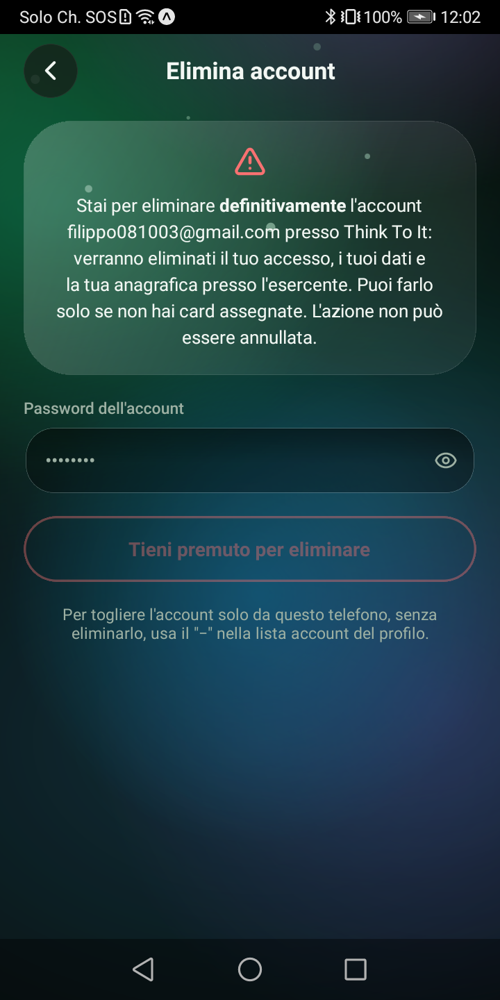

Per togliere un account solo dal telefono, senza eliminarlo, usare il "-" nella lista account o la X nella schermata di login.

## A11. Sessione e comportamento in background

- L'app mantiene la sessione da sola mentre e' aperta (rinnovo ogni 2 minuti).
- Se resta in secondo piano oltre la scadenza (5 minuti lato server), al ritorno rifa' il login con le credenziali salvate in modo trasparente. Se le credenziali non sono piu' valide (password cambiata) si torna al login.
- Senza rete le card gia' caricate restano visibili; compare l'errore solo se non c'e' nulla da mostrare.

## A12. Messaggi d'errore piu' comuni

| Messaggio | Significato |
|---|---|
| Server non raggiungibile | Rete assente o servizio spento |
| Servizio non disponibile, riprova piu' tardi | Il server risponde con errore 5xx |
| Troppe richieste, riprova tra un minuto | Limite di richieste (429) |
| Sessione scaduta | Token non piu' valido e rinnovo non riuscito |
| Codice esercente non valido | Codice inesistente |
| Questo QR non e' di un esercente CardApp | QR scansionato con formato non riconosciuto |
| La password salvata non e' piu' valida | Password cambiata altrove |
| Scanner non disponibile | La build installata non include la fotocamera |

---

# PARTE B - MANUALE TECNICO

## B1. Stack e requisiti

- Expo SDK 57, React Native 0.86.3, React 19.2.3, expo-router 57 (routing a file, `typedRoutes`), React Compiler attivo.
- Grafica: Reanimated 4, react-native-worklets, Skia (card e sfondi), react-native-svg, expo-glass-effect, expo-blur, expo-linear-gradient.
- Moduli nativi: expo-secure-store, expo-local-authentication, expo-camera, expo-brightness, expo-haptics, expo-system-ui.
- TypeScript 6, ESLint (`eslint-config-expo`).
- Identificativi: package/bundle `com.cardapp.app`, scheme `cardapp`, owner Expo `filippoian`, EAS projectId `0069429e-2eb0-4d13-8894-a3a4af5d8428`.

## B2. Struttura del progetto

```
CardApp/
  app.json  eas.json  package.json  .env.local
  android/                cartella nativa generata (prebuild), non modificare a mano
  assets/                 icone, splash, immagini
  src/
    app/                  schermate (expo-router)
      _layout.tsx           provider globali + protezione route + lock/privacy
      (auth)/               login, register, forgot-password
      (app)/                index (home), profile, card-details, add-account,
                            delete-account, pin-setup, recupera-password
      e/[codice].tsx        deep link esercente
    components/ui/        componenti riutilizzabili
    context/              stato globale
    hooks/                hook condivisi
    services/             chiamate cloud, archivio sicuro, PIN, biometria, luminosita'
    constants/            tema, formattazione, colori card
    types/card.ts         tipi di dominio
CardDettaglioMigrator/    strumento .NET separato per il database (vedi B11)
```

## B3. Configurazione e avvio

### Variabile d'ambiente
`EXPO_PUBLIC_CLOUD_URL` (in `.env.local`) sostituisce l'indirizzo del servizio cloud. Senza, vale `https://wsclienticloud.skyoneserver.it`. Esempio test locale: `EXPO_PUBLIC_CLOUD_URL=http://192.168.10.51:5000`. Le variabili `EXPO_PUBLIC_*` sono lette in fase di bundle: dopo una modifica va riavviato Metro (`npx expo start -c`).

### Comandi
```
npm install
npx expo start              # dev client (expo-dev-client e' tra le dipendenze)
npx expo start --go         # Expo Go
npx expo run:android        # compila e installa il development build
npx expo run:ios
npx expo start --web
npm run lint
```

### Expo Go o development build
Il progetto include `expo-dev-client`, quindi `expo start` apre per default il dev client. Per Expo Go serve `--go`. Alcuni moduli (Skia, glass effect, `@expo/ui`) potrebbero non essere inclusi in Expo Go: in quel caso usare il development build. I moduli camera, luminosita' e biometria sono caricati con `optionalNative`: se mancano nella build l'app non crasha ma la funzione risulta non disponibile.

### Test su dispositivo fisico con servizio locale
Telefono e PC sulla stessa LAN, servizio in ascolto su `0.0.0.0`, porta aperta nel firewall di Windows, HTTP in chiaro consentito (Android dev client lo permette in debug).

### Ambiente di test locale
- `wsClientiCloud` (porta 5000) deve partire con `ASPNETCORE_ENVIRONMENT=Development` (login letti da `cloudsystem.fdb` su `wscloudtest.think.to.it`). Con `Test` usa `cloudsystemtest.fdb`, dove l'account di prova non esiste.
- Per le card servono anche `CardBaseUrl` (es. `http://127.0.0.1:5150`, indirizzo di `wsCard`) e `CardClientiKey` (chiave per l'hash delle richieste; con `wsCard` in build Debug la verifica e' disattivata e basta un valore qualsiasi). Senza, `/AUC/CardCliente` risponde "servizio card non configurato".
- `wsCard` (porta 5150) usa il database card `CARD_TEST` (esercente 25, cod `D`). Il cliente cloud e' collegato all'anagrafica tramite `ANAGDAT_CLOUD` (IdCliente, CodEsercente `RQCNVAZSTG`, IdAna).
- Le card si leggono solo se `Cancellata = 0`, appartengono all'anagrafica e l'esercente e' emittente o ha un contatore sulla card.

### Build EAS (`eas.json`)
- `development`: dev client, distribuzione interna.
- `preview`: distribuzione interna.
- `production`: `autoIncrement` (versione remota).

### Dopo modifiche native
Aggiungere o rimuovere dipendenze con codice nativo richiede la ricompilazione del development build. Le cartelle `android/` e `ios/` si rigenerano con `npx expo prebuild --clean`.

## B4. Routing e navigazione

`src/app/_layout.tsx` annida i provider nell'ordine: `ThemeProvider` > `AppLockProvider` > `AuthProvider` > `ParallaxProvider` > `BackgroundFocusProvider` > `CardsProvider` > `RootStack`.

`RootStack`:
- Ritorna `null` (splash visibile) finche' non e' nota la sessione (`isRestoring`) e lo stato del PIN (`lockReady`): evita il lampo del login o del contenuto prima del blocco.
- `Stack.Protected guard={isSignedIn}` mostra il gruppo `(app)`, il guard opposto `(auth)`.
- Sopra tutto: `LockScreen` se `locked`, `PrivacyCover` se `covered`.

Animazione di default: `slide_from_right`.

| Route | File | Note |
|---|---|---|
| `/login` | `(auth)/login.tsx` | param opzionale `cod` |
| `/register` | `(auth)/register.tsx` | param opzionale `cod` |
| `/forgot-password` | `(auth)/forgot-password.tsx` | params `mode=conferma`, `email`, `cod` |
| `/` | `(app)/index.tsx` | home |
| `/profile` | `(app)/profile.tsx` | |
| `/card-details?id=` | `(app)/card-details.tsx` | `id` = idCard |
| `/add-account` | `(app)/add-account.tsx` | param `cod` |
| `/pin-setup?mode=` | `(app)/pin-setup.tsx` | `set` / `change` / `disable` |
| `/delete-account` | `(app)/delete-account.tsx` | |
| `/recupera-password` | `(app)/recupera-password.tsx` | riesporta `forgot-password` |
| `/e/<codice>` | `e/[codice].tsx` | redirect: a `/add-account` se loggato, altrimenti `/login`, con `cod` |

### Deep link
`cardapp://e/<codice>`. `parseEsercenteCode` (`services/esercente-qr.ts`) accetta:
- un indirizzo che termina con `/e/<codice>` (3-32 caratteri alfanumerici, con eventuale `?` o `#` finale),
- oppure il solo codice (4-32 caratteri alfanumerici).
Il risultato e' sempre in maiuscolo; null se non riconosciuto.

## B5. Stato globale (context)

### AuthProvider (`context/auth.tsx`)
Stato: `isSignedIn`, `isRestoring`, `user` (`AuthCliente`), `accountsVersion` (contatore che segnala variazioni dell'elenco account e forza il ricaricamento card).
- All'avvio: `restoreSession()`.
- Keep-alive: ogni 2 minuti (`KEEP_ALIVE_MS`) e a ogni ritorno in primo piano chiama `refreshSession()`; se esito `expired` chiude la sessione.
- Azioni: `signIn`, `signOut` (chiude sessione, non rimuove account), `leaveAccount` (rimuove l'account in uso e passa al primo rimasto, altrimenti login), `switchAccount`, `removeAccount`, `deleteAccount` (prima il server, poi la rimozione locale).

### CardsProvider (`context/cards.tsx`)
Mantiene un gruppo per account salvato (`AccountCards`: key, ragioneSociale, email, cards, loading, error). `loadAll` carica tutti gli account in parallelo; ogni gruppo si aggiorna appena arriva la propria risposta e i dati gia' presenti non tornano mai a "loading". Si ricarica: all'ingresso, al cambio di account attivo o di `accountsVersion`, al ritorno in primo piano, su `reload()`. L'account attivo e' sempre ordinato per primo. `setBlocked` aggiorna il server e poi lo stato locale.

### AppLockProvider (`context/app-lock.tsx`)
Stato: `ready`, `enabled`, `locked`, `covered`, `biometricAvailable`, `biometricEnabled`. Vedi B7.
`withoutLock(op)`: esegue un'operazione che apre un dialogo di sistema (es. permesso fotocamera) senza che l'app sia considerata in background; il contatore viene decrementato dopo 1 secondo.

Altri context: `parallax` (inclinazione del telefono), `background-focus`, `skeleton-shimmer`, `ui-scale`.

## B6. Autenticazione e account salvati

### Archivio account (`services/accounts.ts`)
- Salvati in `expo-secure-store` con chiave `cardapp.accounts.v2` e `keychainAccessible: WHEN_UNLOCKED_THIS_DEVICE_ONLY` (accessibile solo a telefono sbloccato, non incluso nei backup, non trasferito).
- Migrazione automatica dalla chiave precedente `cardapp.accounts` (senza restrizioni): al primo avvio viene copiata e cancellata.
- Struttura: `{ accounts: SavedAccount[], active: string|null, last: string|null }`; `SavedAccount = { codEsercente, ragioneSociale, email, password }`. `last` e' l'ultimo account usato anche dopo l'uscita (proposto al login).
- Chiave account: `CODESERCENTE|email` (codice in maiuscolo, email in minuscolo): `accountKey()`.
- Le password in chiaro nell'archivio sicuro servono a rifare il login quando il token scade.
- Cache in memoria; se l'archivio non e' disponibile (es. web) l'app riparte senza account.

### Servizio auth (`services/auth.ts`)
- Sessione corrente in variabile di modulo `session` (token cloud + `AuthCliente`).
- `signInWithPassword(email, password, codEsercente)`: verifica l'esercente (`InfoEsercente`), fa il login, legge il profilo (`VerificaTokenAccessoCliente`) e solo a login riuscito salva/aggiorna l'account.
- `switchAccount(key)`: login con le credenziali salvate e `setActiveKey`.
- `refreshSession(force)`: ripristina/rinnova la sessione. Le chiamate contemporanee condividono la stessa richiesta (`inflight`); una richiesta forzata non si accontenta di una non forzata in corso. Esiti: `ok`, `offline` (errori transitori: la sessione resta), `expired` (credenziali rifiutate: sessione azzerata).
- `sessionPost`: POST autenticato; su 401 rinnova con `force` e ritenta una volta.
- `cloudAuthedPostFor(key, path, body)`: POST autenticato per conto di qualsiasi account salvato. Per l'account attivo usa la sessione; per gli altri usa una cache di token (`otherTokens`, validita' 4 minuti perche' lato server scadono dopo 5) e rinnova su 401.
- `register`, `requestPasswordReset`, `requestPasswordResetForAccount`, `resendConfirmation`.
- `verifyAccountPassword(key, password)`: login di controllo senza aprire sessione; se la password e' giusta e diversa da quella salvata, la aggiorna.
- `resetLocalAccounts`: svuota account e sessioni locali (nulla sul cloud).
- `deleteAccountOnServer(key, password)`: `POST /AUC/EliminaAccountCliente`.

### Client HTTP (`services/api.ts`)
- `fetch` con timeout di 15 secondi (`AbortController`).
- `Authorization: Bearer <token>` quando presente; `Content-Type: application/json` se c'e' il corpo.
- Busta di risposta `{ cod, msg? }`: `cod = 0` ok, altrimenti `ApiError(cod, msg, status)`.
- Mappature: HTTP 401 -> `ApiError(401, 'Sessione scaduta')`; HTTP 429 -> `ApiError(429, ...)`; corpo non JSON -> `ApiError(-1, ...)` (messaggio diverso se status >= 500); errore di rete/timeout -> `ApiError(-1, 'Server non raggiungibile')`.
- `isTransientError`: `cod` -1, 429 o status >= 500. Gli errori transitori non sono mai un verdetto sulle credenziali (non fanno perdere la sessione, non contano come tentativi di recupero).

## B7. Codice di sblocco e biometria

### PIN (`services/app-lock.ts`)
- 4 cifre (`PIN_LENGTH`). Non viene mai inviato a server.
- Salvato in secure store (`cardapp.pin`) come record `{ salt, hash, fails, lockUntil }`: sale casuale di 16 byte (`crypto.getRandomValues` se disponibile, altrimenti `Math.random`), hash SHA-256 iterato 1000 volte (`HASH_ROUNDS`) con implementazione JS propria (`services/sha256.ts`).
- `isPinSet`: se l'archivio non risponde considera il PIN attivo (meglio chiedere il codice che lasciare l'app aperta).
- `verifyPin`: 5 tentativi liberi (`FREE_ATTEMPTS`); dal 5° errore blocco di 30 s (`FIRST_LOCK_MS`) raddoppiato a ogni errore, massimo 30 min (`MAX_LOCK_MS`). Lo stato di blocco e' persistente.
- Recupero: contatore `cardapp.pinrecovery`, soglia `MAX_RECOVERY_FAILURES = 3`.

### Blocco applicativo (`context/app-lock.tsx`)
- Avvio: se il PIN e' attivo `locked = true`.
- Rientro dal background dopo almeno `LOCK_AFTER_MS` = 30 s -> `locked = true`.
- Copertura (`covered`): Android allo stato `background`, iOS gia' a `inactive`, cosi' l'anteprima del multitasking non mostra dati.
- `recover(accountKey, password)`: verifica la password con il cloud. Errore transitorio -> `status: 'error'`; password rifiutata -> incrementa il contatore, alla soglia chiama `resetLocalAccounts()` + `disable()` e ritorna `reset` (il chiamante chiude anche la sessione); successo -> `disable()`.
- `LockScreen` intercetta il tasto indietro di Android per non far arrivare alle schermate sottostanti.

### Biometria (`services/biometric.ts`)
- Modulo `expo-local-authentication` caricato in modo opzionale.
- Preferenza utente salvata in `cardapp.biometric` (default attiva).
- `isBiometricAvailable`: hardware presente e almeno un volto/impronta registrato.
- `authenticateBiometric`: per lo sblocco app, senza fallback al codice del dispositivo (`disableDeviceFallback`), etichetta "Usa il codice".
- `authenticateDevice`: usata dal login per riaprire un account salvato; accetta anche il codice del telefono; se il dispositivo non ha protezione o il modulo manca ritorna `true`.

## B8. Card, movimenti, QR

### API usate (base `CLOUD_URL`)
| Metodo | Endpoint | Uso |
|---|---|---|
| POST | `/AUC/LoginCliente` | body `{CodEsercente, User, PWD}` -> `{token, idCliente}` |
| GET | `/AUC/VerificaTokenAccessoCliente/{token}` | profilo cliente |
| GET | `/CLE/InfoEsercente/{cod}` | ragione sociale, citta' |
| POST | `/CLE/RegistraClienteApp` | registrazione; risposta con `emailDaConfermare` |
| POST | `/CLE/ResetPwdClienteApp` | link reimpostazione password |
| POST | `/CLE/ReinoltraConfermaClienteApp` | reinvio email di conferma |
| POST (auth) | `/AUC/CardCliente` | elenco card |
| POST (auth) | `/AUC/MovimentiCardCliente` | body `{idCard, pagina, dimensione}`, pagine da 20 |
| POST (auth) | `/AUC/BloccaCardCliente` | body `{idCard, blocca}` -> `{bloccata, modificata}` |
| POST (auth) | `/AUC/EliminaAccountCliente` | body `{pwd}` |

Tutte le risposte hanno la busta `{cod, msg}`. Il token cliente scade dopo 5 minuti.

### Mappatura card (`services/cards.ts`)
- `tipo` del gestionale (`CARDDETTAGLIO`): `Standard`, `PrePagata`, `PostPagata`, `GiftCard` -> `standard | prepaid | postpaid | gift`; qualsiasi altro valore o assenza di dettaglio = standard.
- Contatori: `tipoContatore === 0` = punti, altrimenti `other`. `tipoAssociazione`: 0 card, 1 esercente, 2 circuito.
- Saldo mostrato sulla card: i punti del contatore `principale` (esercente emittente), altrimenti il primo contatore a punti.
- Date: `dataInserimento` `yyyyMMdd`, `ultimoUtilizzo` `yyyyMMddHHmmss` (si tengono i primi 8 caratteri); movimenti `yyyy-MM-ddTHH:mm:ss`.
- Movimenti: `ricarica | spesa | accredito` -> `recharge | expense | credit`. I nomi dei contatori `standard | euro | punti | sconto` sono mappati su `CounterType`.
- Se l'emittente non e' valorizzato si usa la ragione sociale dell'account.

### QR della card
`buildQrPayload(card)` (`services/qr.ts`) restituisce `card.code`, cioe' il codice alfanumerico maiuscolo di 6 caratteri assegnato dal backend. Se il lettore in cassa richiedesse un formato diverso (URL, prefisso, firma) va modificato solo qui.

### Luminosita' (`services/brightness.ts`)
Con almeno un QR visibile la luminosita' sale a 1 con rampa di 450 ms (passi da 30 ms, ease-out) e torna al valore originale alla chiusura dell'ultimo QR. Il valore originale viene dimenticato solo a discesa finita. Modulo `expo-brightness` opzionale.

### Colori card (`constants/card-color.ts`, `components/ui/flip-card.tsx`)
Il colore scelto dall'esercente (`CARDDETTAGLIO.Colore`, es. `#1f4634`, formato `#RGB` o `#RRGGBB`) ha la precedenza e genera una palette (`CardPalette`) per sfondo, curve, testi, riquadro QR, bordo, ombra. Se non valido vale la palette del tipo (prepagata azzurro, postpagata viola-orchidea, standard verde, gift oro, con varianti chiara/scura). La card e' disegnata in SVG su un viewBox 340x214; il flip e' una rotazione Y con prospettiva.

## B9. Componenti principali (`src/components/ui`)

| Componente | Ruolo |
|---|---|
| `flip-card` | Card vettoriale con flip fronte/QR, stato bloccata, parallasse |
| `card-movements` | Elenco movimenti paginato, risposte fuori tempo ignorate, segnaposto al primo carico |
| `cards-skeleton`, `skeleton-loading` | Segnaposto di caricamento |
| `empty-cards` | Stato vuoto animato (si ferma quando la home non e' in primo piano o e' bloccata) |
| `account-list` | Lista account del profilo (cambio, recupero password, rimozione) |
| `account-header`, `account-picker` | Intestazione gruppo account e selettore account |
| `auth-screen` | Layout comune delle schermate di accesso (titolo, passi, azione) |
| `esercente-code-field` | Campo codice con verifica remota (debounce 500 ms, minimo 4 caratteri) e pulsante scanner |
| `saved-esercenti` | Scelta rapida tra esercenti degli account salvati |
| `qr-scanner` | Fotocamera a schermo intero (`expo-camera`) per il QR esercente; gestisce permesso negato e modulo assente |
| `qr-code` | Generazione QR (`react-native-qrcode-svg`) |
| `lock-screen`, `pin-pad`, `privacy-cover` | Schermata del codice, tastierino, copertura privacy |
| `hold-button` | Pulsante "tieni premuto" per azioni distruttive |
| `animated-background`, `glass-panel`, `parallax-view` | Sfondo animato, pannelli vetro, parallasse |
| `text-field`, `button`, `icon-button`, `screen-header` | Elementi base |

Hook: `use-esercente-code` (codice da link o digitato), `use-form-errors` (errori per campo + animazione di scuotimento), `use-lock-countdown` (conto alla rovescia del blocco tentativi), `use-keyboard-cover`, `use-theme`, `use-color-scheme`.

Tema: `constants/theme.ts` (palette chiara/scura, `userInterfaceStyle: automatic`). Formati: `constants/format.ts` (numeri `it-IT`, euro, `dd/MM/yyyy`, `dd/MM/yyyy HH:mm`).

## B10. Sicurezza: riepilogo

- Credenziali, PIN (solo hash con sale), preferenza biometrica e contatori di errore sono in secure store (Keychain/Keystore), `WHEN_UNLOCKED_THIS_DEVICE_ONLY`, esclusi da backup e trasferimenti.
- Il PIN non lascia mai il dispositivo.
- Token cloud solo in memoria, durata 5 minuti, rinnovati rifacendo il login.
- Blocco progressivo dei tentativi PIN persistente; reset dell'app dopo 3 password errate nel recupero.
- Anteprima multitasking coperta; QR non mostrato per card bloccate.
- Eliminazione account: solo sul server, con riconferma password e pressione prolungata.
- Con HTTP in chiaro (solo test locale) credenziali e token viaggiano non cifrati: in produzione usare sempre HTTPS.
- Nota: le password salvate sul dispositivo sono in chiaro all'interno dell'archivio sicuro (necessario per il rinnovo automatico della sessione).

## B11. Strumento CardDettaglioMigrator

Progetto .NET separato (cartella `CardDettaglioMigrator`, con driver FirebirdSql) per il database Firebird del gestionale card. Converte i dati dei dettagli card (`CardDat.Dati`, formato XML) nella tabella `CARDDETTAGLIO` da cui il cloud legge tipo, colore e riferimenti. Non fa parte dell'app mobile.

Uso:
```
CardDettaglioMigrator --selftest
CardDettaglioMigrator --conn "DataSource=...;Database=...;user=...;password=..."            (prova, nessuna scrittura)
CardDettaglioMigrator --conn "..." --apply [--converti-gift] [--solo-schema]                (scrive)
```
Opzioni: `--apply` crea lo schema mancante, salva un backup di `CardDat.Dati` e converte (senza, e' solo una prova in transazione di sola lettura); `--solo-schema` si ferma dopo lo schema; `--converti-gift` converte in gift card le card con `Dati = "GIFT"`; `--accetta-perdite` prosegue anche se la conversione perde dati; `--report <file>` scrive il dettaglio di card scartate/con avvisi (default `report.csv`); `--backup-dati <file>` file del backup scritto prima di ogni modifica. La connessione puo' stare anche nella variabile `CARD_CONN`. Nella cartella sono presenti report di esempio e script SQL.

## B12. Diagnosi dei problemi

| Sintomo | Verifica |
|---|---|
| "Server non raggiungibile" dal telefono | Servizio in ascolto su `0.0.0.0`; stesso segmento di rete; firewall sulla porta; `EXPO_PUBLIC_CLOUD_URL` corretto e Metro riavviato con `-c` |
| 404 aprendo la root del servizio | Normale: gli endpoint sono sotto `/AUC` e `/CLE` |
| Login ok ma nessuna card | `POST /AUC/CardCliente` con il token; verifica assegnazione card nel gestionale; controllare `error` del gruppo in home |
| Tipo/colore card sempre standard/verde | `CARDDETTAGLIO` non popolata: eseguire il migratore |
| "Scanner non disponibile" | Build senza `expo-camera`: ricompilare il dev client |
| Biometria assente nel profilo | Nessun volto/impronta registrato o modulo non incluso nella build |
| L'app chiede il codice troppo spesso su Android | Dialoghi di sistema non incapsulati in `withoutLock` mettono l'app in background |
| Sessione persa dopo il background | Credenziali non piu' valide (password cambiata) -> login; oppure server non raggiungibile (la sessione resta e si riprova) |
| Errore MSB4803 o simili nel migratore | Riferimento a runtime .NET/COM: compilare con l'MSBuild di Visual Studio |

Log: gli errori dei moduli opzionali (`[brightness]`, `[camera]`, `[biometric]`) sono scritti con `console.warn` e visibili nel terminale di Metro.

## B13. Note di manutenzione

- Le cartelle native sono generate: non modificarle a mano.
- Il formato del QR card e' centralizzato in `services/qr.ts`; il formato del QR esercente in `services/esercente-qr.ts`.
- Nuovi tipi di contatore (oggi solo punti) vanno aggiunti in `services/cards.ts` (`counterType`, `COUNTER_TYPES`) e in `formatCounter` di `card-details.tsx`.
- Nuovi tipi di card: `CardKind` in `types/card.ts`, `KINDS` in `services/cards.ts`, `CARD_KIND_LABEL` in `constants/format.ts`, palette in `flip-card`.
- Il percorso `(app)/recupera-password.tsx` riesporta `forgot-password`, cosi' la stessa schermata e' raggiungibile anche da loggati.
